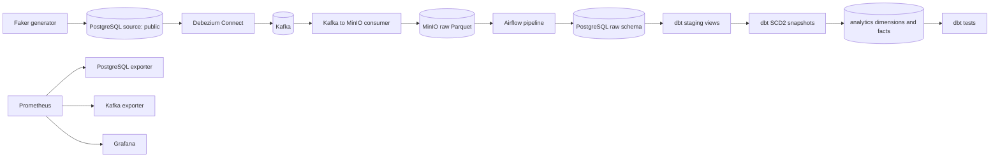

# Data-Bank

A local banking data engineering platform built with PostgreSQL, Debezium, Kafka, MinIO, Airflow, dbt, Prometheus, and Grafana. It has no cloud account or paid database dependency.

## Architecture



The source and analytics data share the `postgres` service but use separate schemas. Airflow metadata is stored in its own `airflow-postgres` service and persistent volume.

## Prerequisites

- Docker Engine and the Docker Compose v2 plugin
- Python 3.11 or newer for running the generator, Kafka consumer, connector registration, or dbt from the host
- At least 6 GB memory available to Docker; the stack runs several JVM and Python services

## Configure and start

1. Copy `.env.example` to `.env`. Replace every `CHANGE_ME` value. Use development-only secrets and do not commit `.env`.
2. If the repository already has a `.env`, keep its existing database credentials; set any missing optional variables from the example without replacing the credentials that own existing data.
3. Start or rebuild the services:

   ```bash
   docker compose up -d --build
   docker compose ps
   ```

Compose preserves the existing bind-mounted PostgreSQL and MinIO directories and the Airflow metadata volume. Do not use `docker compose down -v` for routine restarts.

Ports from the host:

| Service | Address |
| --- | --- |
| PostgreSQL banking database | `localhost:5433` |
| PostgreSQL Airflow metadata | `localhost:5434` |
| Kafka external listener | `localhost:29092` |
| Debezium Connect REST | `http://localhost:8083` |
| MinIO API / console | `http://localhost:9000` / `http://localhost:9001` |
| Airflow UI | `http://localhost:8080` |
| Prometheus | `http://localhost:9090` |
| Grafana | `http://localhost:3000` |

Within Docker, use `postgres:5432`, `kafka:9092`, `minio:9000`, and `connect:8083`; container clients must not use `localhost` to reach another service.

The Airflow username is `airflow`; its local password is the configured `AIRFLOW_DB_PASSWORD`. MinIO uses `MINIO_ROOT_USER` / `MINIO_ROOT_PASSWORD`. Grafana uses `GRAFANA_ADMIN_USER` / `GRAFANA_ADMIN_PASSWORD`. Replace development credentials before exposing any service beyond the local machine.

## Source schema and data generation

On a new data volume, `postgres/schema.sql` runs during PostgreSQL initialization. On an existing database, applying the idempotent schema file is safe and does not delete rows:

```bash
docker compose exec -T postgres sh -c 'psql -v ON_ERROR_STOP=1 -U "$POSTGRES_USER" -d "$POSTGRES_DB"' < postgres/schema.sql
```

The source tables are `public.customers`, `public.accounts`, and `public.transactions`. Generate one batch from the host:

```bash
python -m venv .venv
. .venv/bin/activate
pip install -r requirements.txt
python data-generator/faker_generator.py --once
```

For continuous generation, omit `--once` and stop it with Ctrl+C. The generator reads database connection values from the root `.env`; host-side `POSTGRES_HOST` / `POSTGRES_PORT` should be `localhost` / `5433`.

## Enable CDC and MinIO capture

Register the PostgreSQL connector once after Compose reports PostgreSQL, Kafka, and Connect as healthy:

```bash
python kafka-debezium/generate_and_post_connector.py
curl -s http://localhost:8083/connectors/postgres-connector/status
```

The connector captures the three public source tables and publishes `banking_server.public.<table>` topics. Start the host consumer in another terminal:

```bash
python consumer/kafka_to_minio.py
```

It writes date-partitioned Parquet objects to the `raw` bucket (or configured `MINIO_BUCKET`) and commits Kafka offsets after an upload. Stop it with Ctrl+C to flush partial batches. MinIO console credentials are the configured root user and password.

## Airflow and dbt

Airflow is available at `http://localhost:8080`. Enable and trigger `banking_data_pipeline`. It checks dependencies, loads customers/accounts/transactions from MinIO into the PostgreSQL `raw` schema, checks raw records, runs dbt staging, updates SCD Type 2 snapshots, builds marts, and runs data tests. Retries are safe: the file manifest and Kafka coordinates prevent duplicate ingestion.

dbt uses `dbt-postgres`. For host-side commands, the checked-in profile reads `POSTGRES_*` variables; use host settings (`localhost:5433`). Inside Compose, Airflow supplies the internal host and port. Useful commands:

```bash
cd banking_dbt
set -a
source ../.env
set +a
dbt debug --profiles-dir .dbt
dbt parse --profiles-dir .dbt
dbt compile --profiles-dir .dbt
dbt run --profiles-dir .dbt
dbt snapshot --profiles-dir .dbt
dbt test --profiles-dir .dbt
```

Inside Airflow, the profile is mounted at `/home/airflow/.dbt`; the project is `/opt/airflow/banking_dbt`. Models write to the `staging` and `analytics` schemas. Customer and account snapshots retain previous values and deletion markers with dbt validity columns; dimensions expose live versions and a current-record flag. Transaction facts use an incremental materialization with a transaction ID unique key.

## Monitoring

Prometheus scrapes the PostgreSQL exporter and Kafka exporter. Grafana provisions the Prometheus datasource and a Banking Data Platform dashboard automatically. Open Grafana at `http://localhost:3000`, then review the **Banking Platform** folder. Monitoring services are optional to the core pipeline and are not DAG dependencies.

## Troubleshooting

- `docker compose ps` shows health and startup state. For details use `docker compose logs --tail=100 postgres kafka connect minio airflow-scheduler`.
- PostgreSQL changes made by editing `postgres/schema.sql` do not rerun automatically on an already initialized data directory; apply the idempotent file using the command above.
- If the connector is `FAILED`, inspect `docker compose logs connect` and `GET /connectors/postgres-connector/status`. The existing connector configuration may need updating rather than a second registration.
- If there are no MinIO objects, confirm the Kafka consumer is running and the connector status is `RUNNING`; use the MinIO console to inspect the bucket and `customers/`, `accounts/`, `transactions/` prefixes.
- Airflow task logs show per-file ingestion failures. Failed files remain in MinIO and can be retried. A successful retry changes their manifest status to `processed`.
- Host-side consumers use `localhost:29092` and `localhost:9000`; tasks inside containers use Compose service names.
- Do not delete `docker/postgres/data`, `docker/minio/data`, or the `airflow_postgres_data` volume to troubleshoot. These paths contain persistent data.

## Useful commands

```bash
docker compose ps
docker compose logs -f connect airflow-scheduler
docker compose restart airflow-scheduler airflow-webserver
docker compose down                 # preserves volumes and bind-mounted data
docker compose up -d --build
```

For the implementation audit and validation evidence, see [docs/IMPLEMENTATION_AUDIT.md](docs/IMPLEMENTATION_AUDIT.md) and [docs/PIPELINE_VALIDATION.md](docs/PIPELINE_VALIDATION.md).
